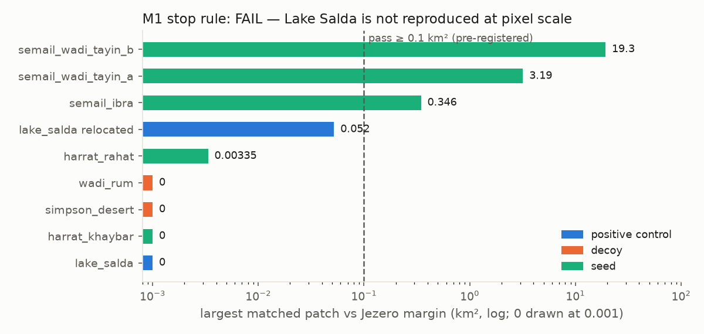
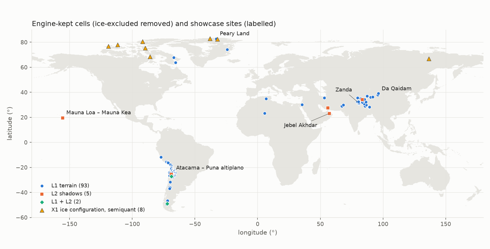
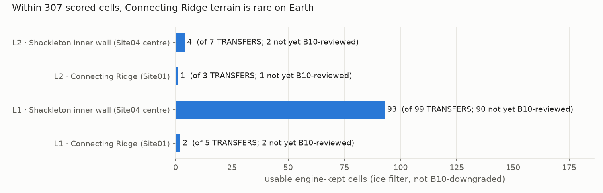

# Validation report — SIMILITUDE engine (v2, 2026-11-14 22:30 UTC+7)

Version 2 replaces the 16:45 draft. It follows the G1 review (`docs/review_g1.md`): three-state
verdicts (TRANSFERS / NO-ANALOG / UNOBSERVED), native rank instead of "σ = 0", M1 by pixel
matching, and a single verdict source. **Every table below is written by
`scripts/report_tables.py` from the pipeline tables**; the prose only interprets them. Run
`scripts/report_tables.py --check` to confirm the report is not stale.

**Reproduce** (after the cached chips/pixels exist):

```bash
.venv/bin/python scripts/run_all.py          # fidelity, null, controls, bridge bias (A5-A8, A16)
.venv/bin/python scripts/l1_robust.py        # A12 robust set
.venv/bin/python scripts/build_verdicts.py   # A15 verdicts.parquet (single source)
.venv/bin/python scripts/l1_profile.py       # A13 names, Attention, ice, contact sheet
.venv/bin/python scripts/sites.py            # 2c sites, scarcity, multi-lens, field/facility
.venv/bin/python scripts/report_tables.py    # refresh the tables of this report
```

## 0. How to read the numbers

- **d** is the Mahalanobis distance from an Earth cell to a planetary target, in units of the
  natural site-to-site variation on the target body (floored by physical tolerances in
  `config/lenses.yaml`). The G1 review showed that "σ = 0" hides more than it says, so ranks are
  reported instead.
- **Native rank** (A11) = how many of the target body's own population footprints (49
  non-overlapping 4 km footprints over six Artemis candidate sites, PGDA 78) are farther from the
  target than the Earth cell. 43/49 means "closer to Connecting Ridge than 43 of 49 real lunar
  sites near the south pole". L1 ranks by `d`, L2 by `d_shadow` (terrain shadows only).
- **Null percentile** = share of 200 stratified random bare-land cells (never ranked) that are
  farther from the target than the cell.
- **Verdicts** (A15, `data/derived/verdicts.parquet`) are the only place a site's status comes
  from. TRANSFERS = the test result is expected to carry over; NO-ANALOG = no Earth site can
  reproduce it (with the facility to use instead); UNOBSERVED = this engine cannot tell.

## 1. Headline results

1. **L1 terrain transfers; within the scored sample, steep crater-wall terrain is common and
   Connecting Ridge terrain is rare.** Of 307 scored cells (300 rank cells = top 300 of 196,008
   bare-land cells by a coarse 90 m slope/relief sigma *against Connecting Ridge*, plus seeds), 99 enter the robust
   set for the Shackleton inner wall (Site04 centre; a steep comparison slope, not a Moon Base
   site) and 5 for Connecting Ridge; after the A13 ice filter 93 vs 2 remain usable (§7). The
   sample was screened towards Connecting Ridge on coarse slope (not on the fine-scale full
   metric that binds it). It is not a global census, and the comparison also reflects how unusual
   each lunar target is within its own population. No usable Connecting Ridge cell that is still
   kept (not downgraded) has yet been through the B10 visual review; the one reviewed L2 cell
   (Gêrzê) was downgraded (§7, columns "B10-downgraded" and "of which B10-unreviewed").
2. **L2: the Sun geometry of the lunar south pole has no Earth analog** (best σ ≈ 13.9, as
   pre-registered in A7); only the terrain-shadow part transfers (10 cell-level TRANSFERS).
3. **M1 fails its pre-registered stop rule.** At pixel level, Semail (Oman) passes and both decoys
   are rejected, but the positive control Lake Salda reaches only 0.052 km² of matched area
   (< 0.1 km²). No M1 hidden analog is published; Jezero and Nili Fossae are NO-ANALOG,
   Oxia and Meridiani UNOBSERVED.
4. **X1 (semi-quantitative): within the X1 scored sample, the three-condition ice
   configuration is met, outside the calibration site, only by high-Arctic cells** (Peary
   Land, Devon Island, Canadian Arctic Archipelago); Beacon Valley (Antarctica) also passes but
   is the calibration site of the condition floors, not a validation. The Pamir–Changtang hypothesis is rejected by the data (wet active layer).
5. **One site carries two engine lenses: L1 engine-confirmed + X1 engine-semiquant** — Peary
   Land, North Greenland. A rank cell found by the coarse screen (not the seed) transfers for
   Connecting Ridge terrain (L1) and lies 20 km from the X1 Peary Land seed (ice configuration).
   The L1 cell has not yet been through the B10 visual review. DESIGN 2.5 #6 had
   proposed Peary Land for L2 (low Sun), which the engine does **not** confirm. The L1 cell carries
   an ice flag (0.15); "only" holds within the scored sample, and it holds at 100, 150 and 200 km.

## 2. Three-state verdicts (A15)

<!-- BEGIN:verdicts -->
| lens | level | TRANSFERS | NO-ANALOG | UNOBSERVED |
|---|---|---|---|---|
| L1 | cell | 104 | 0 | 0 |
| L1 | lens | 0 | 5 | 1 |
| L1 | target | 2 | 0 | 0 |
| L2 | cell | 10 | 0 | 0 |
| L2 | lens | 0 | 6 | 1 |
| L2 | target | 2 | 2 | 0 |
| M1 | lens | 1 | 5 | 2 |
| M1 | target | 0 | 2 | 2 |
| X1 | cell | 8 | 148 | 0 |
| X1 | lens | 1 | 6 | 1 |
| X1 | target | 1 | 0 | 0 |

| lens | target | cells with a cell-level TRANSFERS verdict |
|---|---|---|
| L1 | connecting_ridge | 5 |
| L1 | shackleton_rim | 99 |
| L2 | connecting_ridge | 3 |
| L2 | shackleton_rim | 7 |
| X1 | arcadia_planitia | 8 |
<!-- END:verdicts -->

### Transfer Ledger rows used on every card (NO-ANALOG / UNOBSERVED)

<!-- BEGIN:ledger -->
| lens | target | variable | state | value | facility / why |
|---|---|---|---|---|---|
| L1 |  | gravity | NO-ANALOG | 0.165 | Reduced-gravity offload rig, parabolic flight |
| L1 |  | angle_of_repose | NO-ANALOG | — | Parabolic-flight drum tests or gravity-offload slope tests with the ac |
| L1 |  | atmospheric_pressure | NO-ANALOG | 3e-15 | Thermal-vacuum chamber with regolith simulant |
| L1 |  | radiation_dose | NO-ANALOG | 208 | Accelerator or isotope-source irradiation of components |
| L1 |  | regolith_dust | NO-ANALOG | — | Use lunar simulant under vacuum; do not claim wear or adhesion results |
| L1 |  | Metre-scale boulders and craters < 60 m | UNOBSERVED | — |  |
| L2 |  | gravity | NO-ANALOG | 0.165 | Reduced-gravity offload rig, parabolic flight |
| L2 |  | atmospheric_pressure | NO-ANALOG | 3e-15 | Thermal-vacuum chamber with regolith simulant |
| L2 |  | day_night_cycle | NO-ANALOG | 29.6 | Thermal-vacuum cycling of hardware |
| L2 |  | radiation_dose | NO-ANALOG | 208 | Accelerator or isotope-source irradiation of components |
| L2 |  | temperature | NO-ANALOG | — | Cryogenic test bench for ice-regolith drilling and mobility |
| L2 |  | diffuse_skylight | NO-ANALOG | — | Add artificial single-source lighting with black enclosures, or night  |
| L2 |  | Horizon occlusion beyond 10 km | UNOBSERVED | — |  |
| L2 | connecting_ridge | sun_geometry | NO-ANALOG | 13.9 | High-latitude summer field site or lighting rig for the solar geometry |
| L2 | shackleton_rim | sun_geometry | NO-ANALOG | 13.9 | High-latitude summer field site or lighting rig for the solar geometry |
| M1 |  | gravity | NO-ANALOG | 0.38 | Reduced-gravity offload rig, parabolic flight |
| M1 |  | atmospheric_pressure | NO-ANALOG | 0.0063 | Mars-pressure CO2 chamber |
| M1 |  | radiation_dose | NO-ANALOG | 102 | Accelerator or isotope-source irradiation of components |
| M1 |  | temperature | NO-ANALOG | 0.743 | Cold-chamber tests; polar or high-altitude desert sites only as partia |
| M1 |  | perchlorate | NO-ANALOG | — | Dope simulant with perchlorate salts |
| M1 |  | Hydration bands at 1.4 and 1.9 um | UNOBSERVED | — |  |
| M1 |  | Serpentine vs Mg-carbonate | UNOBSERVED | — |  |
| M1 | oxia_planum | aqueous_mineral | UNOBSERVED | — |  |
| M1 | meridiani | aqueous_mineral | UNOBSERVED | — |  |
| M1 | jezero_margin | aqueous_mineral | NO-ANALOG | 0.052 |  |
| M1 | nili_fossae_olivine | aqueous_mineral | NO-ANALOG | 0.052 |  |
| X1 |  | gravity | NO-ANALOG | 0.38 | Reduced-gravity offload rig, parabolic flight |
| X1 |  | angle_of_repose | NO-ANALOG | — | Parabolic-flight drum tests with the actual simulant |
| X1 |  | atmospheric_pressure | NO-ANALOG | 0.0063 | Mars-pressure CO2 chamber |
| X1 |  | radiation_dose | NO-ANALOG | 102 | Accelerator or isotope-source irradiation of components |
| X1 |  | temperature | NO-ANALOG | 0.743 | Cold-chamber tests; polar or high-altitude desert sites only as partia |
| X1 |  | perchlorate | NO-ANALOG | — | Dope simulant with perchlorate salts |
| X1 |  | Overburden dielectric properties (radar / GPR response) | UNOBSERVED | — |  |
<!-- END:ledger -->

## 3. L1 — Touchdown & Traverse

- Population for Σ: 49 non-overlapping 4 km footprints across six Artemis candidate sites
  (PGDA Product 78, 5 m LOLA DEM aggregated to 30 m). Earth: 300 ranked cells (coarse GEE screen,
  NMS 30 km), 200 stratified random bare-land cells, controls and seeds; Copernicus GLO-30 at
  30 m, same 4 km footprint rule on both bodies.
- **Robust set (A12).** A cell is kept only when its native rank is ≥ n/2 under all three
  configurations: (i) the diagonal metric on 11 descriptors, (ii) a full metric on 6
  descriptors, (iii) a coarser baseline L = 60 m recomputed from the cached chips. Configuration
  (ii) is the binding one for Connecting Ridge.

<!-- BEGIN:l1_robust -->
| target | rank+seed cells | (i) diagonal 11 descriptors | (ii) full metric 6 descriptors | (iii) L = 60 m | robust set (i)∩(ii)∩(iii) |
|---|---|---|---|---|---|
| connecting_ridge | 307 | 119 | 5 | 75 | 5 |
| shackleton_rim | 307 | 171 | 139 | 203 | 99 |
<!-- END:l1_robust -->

- **Controls and seeds.** Haughton (`high`, NASA's best-known Moon/Mars field site) misses on
  both targets (native rank 0/49; limiting factor `frac_gt8`). Haughton is a geology/operations
  analog, not a steep-ridge terrain analog; the expectation is kept as written. SP Crater
  (`uncertain`) is the closest control. Peary Land is the closest seed.

<!-- BEGIN:terrain_controls -->
| lens | target | control / seed | expected | native rank | rank basis | null percentile |
|---|---|---|---|---|---|---|
| L1 | connecting_ridge | CTRL_Mistastin | — | 0/49 | d | 79.5 |
| L1 | connecting_ridge | CTRL_Mistastin_reloc | — | 0/49 | d | 65.5 |
| L1 | connecting_ridge | CTRL_haughton_devon | high | 0/49 | d | 81.5 |
| L1 | connecting_ridge | CTRL_kilauea_lava | uncertain | 5/49 | d | 86.5 |
| L1 | connecting_ridge | CTRL_lava_beds_california | uncertain | 3/49 | d | 84.5 |
| L1 | connecting_ridge | CTRL_meteor_crater_arizona | uncertain | 5/49 | d | 87 |
| L1 | connecting_ridge | CTRL_sp_crater_black_point | uncertain | 25/49 | d | 96.5 |
| L1 | connecting_ridge | SEED_Harrat_Khaybar | seed | 10/49 | d | 93.5 |
| L1 | connecting_ridge | SEED_Karakul | seed | 0/49 | d | 3.5 |
| L1 | connecting_ridge | SEED_Karakul_reloc | seed | 23/49 | d | 96.5 |
| L1 | connecting_ridge | SEED_Peary_Land | seed | 21/49 | d | 95.5 |
| L1 | connecting_ridge | SEED_Roter_Kamm | seed | 8/49 | d | 89.5 |
| L1 | connecting_ridge | SEED_Tenoumer | seed | 0/49 | d | 82.5 |
| L1 | connecting_ridge | SEED_Wolfe_Creek | seed | 0/49 | d | 51 |
| L1 | shackleton_rim | CTRL_Mistastin | — | 0/49 | d | 75.5 |
| L1 | shackleton_rim | CTRL_Mistastin_reloc | — | 0/49 | d | 67 |
| L1 | shackleton_rim | CTRL_haughton_devon | high | 0/49 | d | 80 |
| L1 | shackleton_rim | CTRL_kilauea_lava | uncertain | 0/49 | d | 83.5 |
| L1 | shackleton_rim | CTRL_lava_beds_california | uncertain | 0/49 | d | 83 |
| L1 | shackleton_rim | CTRL_meteor_crater_arizona | uncertain | 0/49 | d | 83 |
| L1 | shackleton_rim | CTRL_sp_crater_black_point | uncertain | 8/49 | d | 93 |
| L1 | shackleton_rim | SEED_Harrat_Khaybar | seed | 2/49 | d | 89 |
| L1 | shackleton_rim | SEED_Karakul | seed | 0/49 | d | 3 |
| L1 | shackleton_rim | SEED_Karakul_reloc | seed | 7/49 | d | 92 |
| L1 | shackleton_rim | SEED_Peary_Land | seed | 4/49 | d | 90.5 |
| L1 | shackleton_rim | SEED_Roter_Kamm | seed | 0/49 | d | 84 |
| L1 | shackleton_rim | SEED_Tenoumer | seed | 0/49 | d | 82 |
| L1 | shackleton_rim | SEED_Wolfe_Creek | seed | 0/49 | d | 53 |
| L2 | connecting_ridge | CTRL_Kilauea | — | 0/49 | d_shadow | 6.5 |
| L2 | connecting_ridge | CTRL_Lava_Beds | — | 0/49 | d_shadow | 74.5 |
| L2 | connecting_ridge | CTRL_Mistastin | — | 0/49 | d_shadow | 92 |
| L2 | connecting_ridge | CTRL_SP_Crater | — | 0/49 | d_shadow | 95.5 |
| L2 | connecting_ridge | CTRL_haughton_devon_l2 | high | 0/49 | d_shadow | 83.5 |
| L2 | connecting_ridge | CTRL_sahara_lowlat_l2 | low | 0/49 | d_shadow | 80 |
| L2 | connecting_ridge | SEED_Harrat_Khaybar | seed | 1/49 | d_shadow | 93 |
| L2 | connecting_ridge | SEED_Karakul | seed | 0/49 | d_shadow | 62.5 |
| L2 | connecting_ridge | SEED_Peary_Land | seed | 0/49 | d_shadow | 99.5 |
| L2 | connecting_ridge | SEED_Roter_Kamm | seed | 0/49 | d_shadow | 87.5 |
| L2 | connecting_ridge | SEED_Tenoumer | seed | 0/49 | d_shadow | 79 |
| L2 | connecting_ridge | SEED_Wolfe_Creek | seed | 0/49 | d_shadow | 62.5 |
| L2 | shackleton_rim | CTRL_Kilauea | — | 0/49 | d_shadow | 10 |
| L2 | shackleton_rim | CTRL_Lava_Beds | — | 0/49 | d_shadow | 75.5 |
| L2 | shackleton_rim | CTRL_Mistastin | — | 0/49 | d_shadow | 84.5 |
| L2 | shackleton_rim | CTRL_SP_Crater | — | 0/49 | d_shadow | 95.5 |
| L2 | shackleton_rim | CTRL_haughton_devon_l2 | high | 0/49 | d_shadow | 81 |
| L2 | shackleton_rim | CTRL_sahara_lowlat_l2 | low | 0/49 | d_shadow | 81.5 |
| L2 | shackleton_rim | SEED_Harrat_Khaybar | seed | 0/49 | d_shadow | 91 |
| L2 | shackleton_rim | SEED_Karakul | seed | 0/49 | d_shadow | 56.5 |
| L2 | shackleton_rim | SEED_Peary_Land | seed | 0/49 | d_shadow | 99.5 |
| L2 | shackleton_rim | SEED_Roter_Kamm | seed | 0/49 | d_shadow | 83.5 |
| L2 | shackleton_rim | SEED_Tenoumer | seed | 0/49 | d_shadow | 76 |
| L2 | shackleton_rim | SEED_Wolfe_Creek | seed | 0/49 | d_shadow | 62.5 |
<!-- END:terrain_controls -->

- **Coordinate corrections (A14).** One rule for all points: if less than 50 % of the footprint
  is valid land (not WorldCover water, DEM present), move to the nearest footprint with ≥ 50 %.
  Original and corrected rows are both kept (`*_reloc`). The correction rescues Karakul (its
  seed coordinate was on the lake surface) and does not rescue Mistastin.

<!-- BEGIN:relocations -->
| point | lens | valid land before | after | shift km | σ before | σ after | pct before | pct after |
|---|---|---|---|---|---|---|---|---|
| SEED_Karakul | L1 | 0 | 0.501 | 3.88 | 15.5 | 1.15 | 3.5 | 96.5 |
| CTRL_Mistastin | L1 | 0.36 | 0.501 | 5.24 | 6.52 | 7.96 | 79.5 | 65.5 |
| lake_salda | M1 | 0.016 | 0.501 | 2.65 | — | — | — | — |
<!-- END:relocations -->

## 4. L2 — Low-Sun Navigation

- Sun geometry (`lowsun_frac_daylight`, `lowsun_az_coverage`; same formula, obliquity 1.54° for
  the Moon and 23.44° for Earth) is **NO-ANALOG** for both targets: at the lunar south pole the
  Sun always stays within a few degrees of the horizon; on Earth that needs latitudes ≥ ~83–86°,
  where there is almost no bare land. Facility: a high-latitude summer field site for partial
  geometry or a lighting rig.
- Terrain shadows at 2/5/7° Sun elevation **transfer** in 10 cells (3 Connecting Ridge,
  7 Shackleton inner wall), ranked by `d_shadow` native rank. Diffuse skylight (no black
  shadows on Earth) is a NO-ANALOG ledger row.
- Pre-registered checks are not informative on the astro axis (every Earth cell is far), so
  neither the Haughton control nor the Sahara decoy separates — reported as is.

## 5. M1 — Aqueous minerals (pixel matching, B13)

The G1 review replaced footprint-median spectra with **pixel matching** at EMIT 60 m: target
diagnostic families after Viviano-Beck et al. (2014) browse products, a one-sided presence gate,
a noise floor from null pixels (B14b), 8-connected matched area. Rules were committed in B14a
before any pixel was scored.



<!-- BEGIN:m1 -->
| site | largest matched patch km² |
|---|---|
| ctl_lake_salda__relocated | 0.052 |
| ctl_lake_salda | 0 |
| seed_semail_wadi_tayin_a | 3.19 |
| seed_semail_wadi_tayin_b | 19.3 |
| seed_semail_ibra | 0.346 |
| ctl_wadi_rum | 0 |
| ctl_simpson_desert | 0 |
| seed_harrat_khaybar | 0 |
| seed_harrat_rahat | 0.00335 |

Rule: B13 stop rule (PLAN 2b, pre-registered in B14a): Lake Salda (A14 coordinates) and Semail pass, Wadi Rum and Simpson rejected; pass = largest_patch_km2 >= 0.1 (target jezero_margin). Noise floor (q95 of null pixels, B14b): D2300 0.11, MIN2295_2480 0.0396, OLINDEX 0.2734. Checks: lake_salda_relocated_passes = False, semail_wadi_tayin_a_passes = True, wadi_rum_rejected = True, simpson_desert_rejected = True. **Verdict: FAIL** (evaluated 2026-11-14T20:23). M1 is presented only as a method illustration on 4 sites plus the negative result at footprint scale; no M1 hidden analog is published (seeds/rank results are recorded, not published).
<!-- END:m1 -->

**Why the footprint-median engine misled (bridge bias, A16).** Median z of Earth cells against
each Mars target, per CRISM summary parameter computed identically on EMIT and on MICA type
spectra. Continuum-sensitive parameters (HCPINDEX, BD2250, MIN2250) have a negative median z
on every target (between about −1.4 and −7, table below): dusty, atmosphere-corrected Mars I/F and Earth surface reflectance do not share a
continuum, so those parameters are left out of the fidelity vector.

<!-- BEGIN:bridge -->
| parameter | continuum_sensitive | in_fidelity | jezero_margin | meridiani | nili_fossae_olivine | oxia_planum |
|---|---|---|---|---|---|---|
| HCPINDEX | True | False | -4.92 | -7.03 | -6.47 | -5.89 |
| MIN2295_2480 | False | True | -3.31 | -1.03 | -0.141 | -1.18 |
| BD2290 | False | True | -2.97 | -0.181 | -0.279 | -1.19 |
| BD2265 | False | True | -2.93 | -3.23 | -1.78 | -2.11 |
| BD1300 | False | True | -2.86 | -0.152 | -3.91 | -0.413 |
| OLINDEX | True | True | -2.42 | 0.444 | -2.47 | 0.786 |
| BD2250 | True | False | -1.96 | -4 | -1.98 | -1.43 |
| D2300 | False | True | -1.81 | 0.45 | -0.545 | -0.7 |
| MIN2250 | True | False | -1.73 | -3.57 | -2.61 | -1.98 |
| BD2230 | False | True | -0.804 | -0.903 | -1.02 | -0.881 |
| BD2100 | False | True | -0.631 | -1.54 | -1.88 | -1.41 |
| BD2165 | False | True | -0.113 | -0.664 | -0.959 | -0.661 |
| MIN2345_2537 | False | True | 0.187 | 1.71 | 0.521 | 0.43 |
| BD2190 | False | True | 0.435 | -0.159 | -0.3 | 0.0377 |
| LCPINDEX | False | True | 1.28 | -1.72 | 2.05 | -1.59 |
| SINDEX | False | True | 1.58 | -0.315 | -0.0819 | -0.116 |
| BD2210 | False | True | 1.58 | -0.142 | 0.758 | 1.35 |
| BD2355 | False | True | 1.78 | 1.41 | 0.388 | 0.619 |

z = (Earth − target) / tolerance scale; median over Earth cells; level: footprint-median spectrum (not pixel).
<!-- END:bridge -->

## 6. X1 — Ice under dry overburden (semi-quantitative)

Three conditions (B15): (1) permafrost, (2) no thaw down to the ice table (few surface
freeze–thaw days is an exclusion condition, not a similarity axis), (3) dry overburden
(P/PET ≤ 0.5, UNEP semi-arid limit). Floors were set **after** seeing the data and calibrated on
Beacon Valley, so Beacon Valley passing is a calibration, not a validation. Soil temperature is
ERA5-Land reanalysis (~9 km grid), not an observation. Maximum status: `engine-semiquant`.

<!-- BEGIN:x1 -->
| cell_id | sample_role | n_met | failed | ice_check | passes_all |
|---|---|---|---|---|---|
| ctl_axel_heiberg_eureka | control | 3 | - | ok | True |
| ctl_beacon_valley | control | 3 | - | not assessed (outside ESA WorldCover) | True |
| ctl_yakutsk_lowland | decoy | 1 | permafrost, no_thaw_to_ice | ok | False |
| ctl_west_siberia_lowland | decoy | 0 | permafrost, no_thaw_to_ice, dry_overburden | ok | False |
| seed_east_pamir_murghab | seed | 2 | no_thaw_to_ice | ok | False |
| seed_karakul_structure | seed | 1 | permafrost, no_thaw_to_ice | ok | False |
| seed_west_kunlun_aksai_chin | seed | 2 | no_thaw_to_ice | ok | False |
| seed_changtang_north | seed | 2 | no_thaw_to_ice | ok | False |
| seed_qiangtang_east | seed | 1 | no_thaw_to_ice, dry_overburden | excluded: glacier ice | False |
| seed_kunlun_pass | seed | 1 | no_thaw_to_ice, dry_overburden | ok | False |
| seed_mongolian_altai_south | seed | 1 | permafrost, no_thaw_to_ice | ok | False |
| seed_peary_land | seed | 3 | - | flag: some ice | True |
| seed_devon_island | seed | 3 | - | ok | True |
| seed_svalbard_adventdalen | seed | 1 | no_thaw_to_ice, dry_overburden | ok | False |
| seed_puna_high | seed | 1 | permafrost, no_thaw_to_ice | ok | False |
| seed_tianshan_central | seed | 1 | no_thaw_to_ice, dry_overburden | excluded: glacier ice | False |

Rank + null cells: 400; meeting all three conditions, not glacier ice, qa ok: 7 (rank_0038, rank_0040, rank_0058, rank_0087, rank_0123, null5_0011, null5_0042). Cell-level X1 TRANSFERS in verdicts.parquet (rank + seed; the A15 rule does not use qa_flag): 8; with a qa flag other than ok: rank_0056 (qa vegetated).
<!-- END:x1 -->

## 7. From cells to field sites (PLAN 2c, post hoc)

Contract in `config/sites.yaml`; cards in `docs/field_facility.md`. Engine-kept L1/L2 cells
(A13) are grouped into sites by single linkage at 150 km, without ice-excluded cells. A site's
lens counts only when a member cell (or an X1 partner cell within 150 km) has a cell-level
TRANSFERS verdict; X1 is always reported as engine-semiquant, never engine-confirmed. A lens whose
cells were all downgraded by the B10 visual review
is shown as `hypothesis`, never as a finding. A site with a cell inside a known-analog exclusion
buffer is never called hidden; unknown Attention is never hidden either. Until site Attention is
queried (after 07:00 15/11), every `hidden_status` is `unknown` and the word "hidden" must not be
used on slides or the web. B10-downgraded cells do not trigger the showcase rule (a).



### Target scarcity (both sides of a comparison use the same filter)



Figures are drawn from the same tables by `scripts/figures_report.py`.

<!-- BEGIN:scarcity -->
| lens | target | TRANSFERS cells | ice ok | ice flag | ice excluded | usable | usable outside known-analog buffers | sites | usable, B10-downgraded | usable, not B10-downgraded (incl. unreviewed) | of which B10-unreviewed |
|---|---|---|---|---|---|---|---|---|---|---|---|
| L1 | Connecting Ridge (Site01) | 5 | 1 | 1 | 3 | 2 | 2 | 2 | 0 | 2 | 0 |
| L1 | Shackleton inner wall (Site04 centre) | 99 | 90 | 3 | 6 | 93 | 54 | 27 | 0 | 93 | 90 |
| L2 | Connecting Ridge (Site01) | 3 | 2 | 0 | 1 | 2 | 1 | 2 | 1 | 1 | 0 |
| L2 | Shackleton inner wall (Site04 centre) | 7 | 5 | 1 | 1 | 6 | 4 | 5 | 2 | 4 | 2 |
<!-- END:scarcity -->

### Sensitivity to the post hoc distance

<!-- BEGIN:site_sensitivity -->
| km (cluster = multi-lens) | sites | sites with an engine partner (L1/L2 + X1) | showcase |
|---|---|---|---|
| 100 | 43 | Peary Land, North Greenland | Zanda (Tsamda) and Gar, Ngari, western Tibet (c); Mauna Loa – Mauna Kea, Hawaiʻi (a); Da Qaidam, northern Qaidam Basin margin (Qinghai) (a); Peary Land, North Greenland (a,b) |
| 150 | 31 | Peary Land, North Greenland | Atacama – Puna altiplano (Chile, Argentina, Bolivia) (b); Zanda (Tsamda) and Gar, Ngari, western Tibet (c); Da Qaidam, northern Qaidam Basin margin (Qinghai) (a); Mauna Loa – Mauna Kea, Hawaiʻi (a); Jebel Akhdar, Hajar Mountains (Oman) (b); Peary Land, North Greenland (a,b) |
| 200 | 27 | Peary Land, North Greenland | Atacama – Puna altiplano (Chile, Argentina, Bolivia) (b); Gêrzê, central Changtang plateau (Tibet) (c); Da Qaidam, northern Qaidam Basin margin (Qinghai) (a); Mauna Loa – Mauna Kea, Hawaiʻi (a); Jebel Akhdar, Hajar Mountains (Oman) (b); Peary Land, North Greenland (a,b) |
<!-- END:site_sensitivity -->

### Multi-lens pairs

<!-- BEGIN:multilens -->
| site | cell_id | lenses | partner_lens | partner_label | distance_km | partner_state |
|---|---|---|---|---|---|---|
| Atacama – Puna altiplano (Chile, Argentina, Bolivia) | E10K_-271_-653 | L1 | M1 | seed Salar de Uyuni margin | 149 | literature-only |
| Jebel Akhdar, Hajar Mountains (Oman) | E10K_289_551 | L2 | M1 | seed Semail ophiolite, Wadi Tayin A | 129 | literature-only |
| Jebel Akhdar, Hajar Mountains (Oman) | E10K_289_551 | L2 | M1 | seed Semail ophiolite, Wadi Tayin B | 106 | literature-only |
| Jebel Akhdar, Hajar Mountains (Oman) | E10K_289_551 | L2 | M1 | seed Semail ophiolite, Ibra | 143 | literature-only |
| Peary Land, North Greenland | E10K_729_-319 | L1 | X1 | seed_peary_land (Peary Land polar desert (Greenland)) | 20.1 | engine TRANSFERS |
| Peary Land, North Greenland | E10K_729_-319 | L1 | X1 | rank_0123 (rank sample) | 82.7 | engine TRANSFERS |
<!-- END:multilens -->

### Showcase sites (rule: Connecting Ridge cell, multi-lens partner, or largest site outside buffers)

<!-- BEGIN:sites -->
| name | n_cells | max_span_km | lenses_engine_confirmed | lenses_engine_semiquant | lenses_hypothesis | n_b10_unreviewed | lenses_literature_only | n_ice_flag | n_in_exclusion | attention_n | hidden_status | showcase |
|---|---|---|---|---|---|---|---|---|---|---|---|---|
| Atacama – Puna altiplano (Chile, Argentina, Bolivia) | 54 | 1108 | L1,L2 |  |  | 53 | M1 | 1 | 40 | — | no: inside known-analog buffer | b |
| Zanda (Tsamda) and Gar, Ngari, western Tibet | 5 | 206 | L1 |  |  | 5 |  | 0 | 0 | — | unknown: attention not known | c |
| Da Qaidam, northern Qaidam Basin margin (Qinghai) | 2 | 143 | L1 |  |  | 1 |  | 0 | 0 | — | unknown: attention not known | a |
| Mauna Loa – Mauna Kea, Hawaiʻi | 1 | 0 | L2 |  |  | 0 |  | 0 | 1 | — | no: inside known-analog buffer | a |
| Jebel Akhdar, Hajar Mountains (Oman) | 1 | 0 | L2 |  |  | 0 | M1 | 0 | 0 | — | unknown: attention not known | b |
| Peary Land, North Greenland | 1 | 0 | L1 | X1 |  | 0 |  | 1 | 0 | — | unknown: attention not known | a,b |
<!-- END:sites -->

## 8. Deviations from pre-registration

Rules decided or changed after some results were seen. Git commit times (UTC+7) are the
evidence of order; where git cannot prove the order, the row says so.

| # | What changed | When / evidence | Why | Affects |
|---|---|---|---|---|
| 1 | Discovery requires σ ≤ 2 besides percentile ≥ 90 | 14/11 16:17, `33cf4d9` | Percentile alone marked the nearest cell `engine-confirmed` even when every cell was far (L2 σ ≈ 14, M1 σ ≈ 3) | Candidate selection until B16, which now reads only `verdicts.parquet` |
| 2 | X1 permafrost made a gate | afternoon 14/11, B6/B9 (`b76b21f`, `74a9ce5`) | Wet, thawing Tibetan/Pamir cells ranked high on similarity | X1 ranking; superseded by the B15 checklist |
| 3 | X1 condition floors (MAAT ≤ −1 °C, ≤ 20 freeze–thaw days/yr, P/PET ≤ 0.5) set from Beacon Valley | 17:32, `677777a` | No pre-registered floor existed | Every X1 TRANSFERS; Beacon Valley is calibration only |
| 4 | Unknown Attention counts as "not known", never as hidden | 17:34, `4ce40cf` | Missing OpenAlex counts were treated as 0 | Hidden selection on all lenses |
| 5 | New M1 analog target `nili_fossae_olivine` | G1, 16:50 | Olivine–carbonate target needed for the pixel families | M1 targets |
| 6 | X1 decoys (Yakutsk lowland, West Siberia lowland) and the whole B0 contract | committed 16:02 (`a096b05`); the file header says "locked 13:45" | The 13:45 lock cannot be proven from git: the files were committed after the first scores existed | X1 decoy checks |
| 7 | D2300 / BD2100 continuum anchors moved inside the EMIT windows | B1/B3, before the first M1 scores | Original anchors fall in Earth's 1.8–1.95 µm water band; moved identically on both sides | M1 descriptors |
| 8 | BD1750 dropped | B3, `config/lenses.yaml` note | EMIT −0.01 fill starts at ~1765 nm in recent scenes (no right shoulder) | M1 descriptors |
| 9 | M1 switched to pixel matching with a presence gate and noise floor | G1 16:50; rules committed in B14a (`66f9da7`) before any pixel | Footprint medians matched featureless basalt to smectite targets | All M1 results |
| 10 | Oxia Planum and Meridiani moved to UNOBSERVED; Harrat Rahat/Khaybar/Pinacate removed from candidates | G1a, 16:50 | Target diagnostic depths sit at the tolerance floor (empty match) | M1 targets and web |
| 11 | A12 robust-set threshold native rank ≥ n/2 | 20:28, `ed0a2a7` | Chosen after seeing a 38 % probe | L1 robust set (5 / 99) |
| 12 | Coordinates corrected for Karakul, Mistastin, Lake Salda (one rule, both rows kept) | 20:10–20:11, `b356b5c`, `f89b501` | Footprints mostly on water | §3 relocation table; Lake Salda pixels in B13 |
| 13 | X1 temperature source changed to ERA5-Land soil temperature | B6 | MODIS LST is clear-sky skin temperature, not ground temperature | X1 condition (1) |
| 14 | Deadlines inside phase 2b moved as needed (Data Freeze 03:00 kept) | team decision 20:30 | Progress | M1 stop rule evaluated 20:23 on data, not on time |
| 15 | Target label `shackleton_rim` shown as "Shackleton inner wall (Site04 centre)" | G1 proposal (15:10), applied in 2c | The Site04 centre chip has a 31° median slope (A3): inner wall, not rim crest | Labels only; target id and chip unchanged |
| 16 | Sites = single-linkage clusters at 150 km; multi-lens radius 150 km | 2c, ~21:50 | Cells (4 km) are not field campaigns | §7 tables |
| 17 | Showcase rule (a)/(b)/(c); rule (a) changed at gate 1 round 3 for 2c (2026-11-14 evening, after the first site run) to count only cells not downgraded by B10, knowing that this drops Gêrzê | 2c | Avoid hand-picking showcase sites; a `hypothesis` must not pick a card | Which cards are shown; Gêrzê leaves the showcase at 100 and 150 km (stays at 200 km by rule c) |
| 18 | Site names set by hand; site Attention = max(site-name query, member cells) | 2c | Cell-level names are county names (Attention 0 for 93/99 cells) | Hidden status |
| 19 | Ice-flagged cells kept as site members, ice-excluded cells dropped | 2c (A13 thresholds were committed before results) | Same thresholds as A13/X1 | Site membership |
| 20 | 2c implemented before its gate-1 review | 2c log | Time; gate 1 round 1 returned REVISE, fixed | §7 |
| 21 | Site Attention queried after Data Freeze (OpenAlex daily budget) | after 07:00 15/11 | Free budget exhausted on 14/11 | Hidden status of sites (shown as unknown until then) |
| 22 | B10 visual-review downgrades cap a site's lens at `hypothesis` | 2c gate round 2 | Hard rule: no `hypothesis` on slides | Gêrzê L2, other downgraded L2 cells; Gêrzê leaves the showcase |
| 23 | X1 seed list (incl. Peary Land) committed with the first X1 scores | 16:02, `b76b21f` | Contract and results pushed together | X1 seeds are not provably pre-registered |

## 9. Limitations and not done

- **Below-pixel analogs**: boulders and craters < 60 m (L1), horizon occlusion beyond 10 km
  (L2), radar/GPR response of the overburden (X1) are UNOBSERVED.
- **Hydration bands at 1.4 and 1.9 µm** are hidden by Earth's atmosphere in EMIT; serpentine vs
  Mg-carbonate cannot be separated with the 2.3 µm feature alone. EMIT covers only about ±52°,
  so the spectral lens does not reach the poles.
- **Ablation (a) RGB/texture baseline** was not run (no LROC chips on the Moon side).
- **Attention** is an OpenAlex title/abstract count; place names at county level return 0 almost
  everywhere, so cell-level Attention is not evidence of being hidden.
- **X1** uses reanalysis and clear-sky MODIS data; it is semi-quantitative by design.
- Every number on the slides and the web must come from the tables above or from
  `docs/field_facility.md`.
